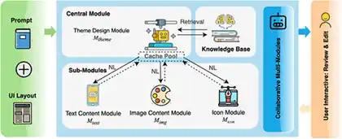
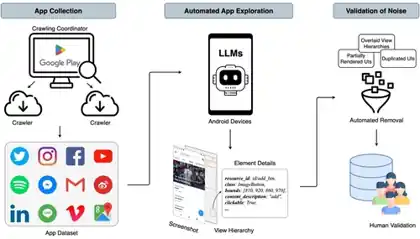
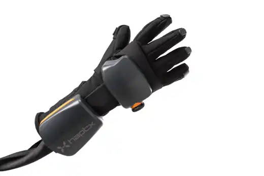
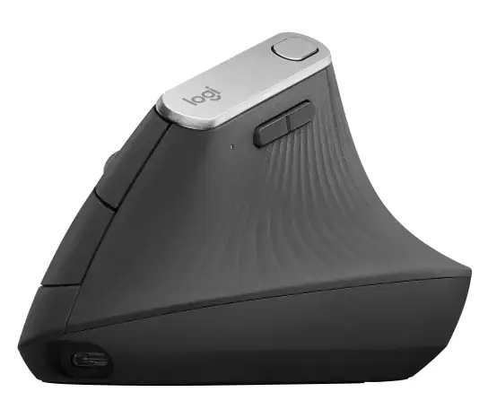

Homework 2 covers three lecture tasks. I first looked at a current HCI researcher, then revisited an early vision of immersive computing, and finally analysed an alternative input device from an HCI perspective.

## Lecture 4 — Present One HCI Researcher

### Sidong Feng — Human, Software, and AI Interaction

For this task, I chose **Dr. Sidong Feng**, an Assistant Professor at the School of Data Science, The Chinese University of Hong Kong, Shenzhen.

I chose him because his work is close to an area I am personally interested in: the connection between **software engineering, HCI, large language models, and AI agents**.

His recent research includes GUI automation, intelligent software testing, visual bug understanding, and agent-based interaction with user interfaces. What I find interesting is that these topics are no longer only about making software easier for humans to use. They also ask whether an AI agent can understand and operate the same interface.

### Current Research Projects

Three projects are good examples of the HCI side of his research.

**Towards Human-AI Synergy in UI Design: Supporting Iterative Generation with LLMs** explores how LLMs can support an iterative UI design process while keeping the human designer involved in refinement.

**MUD: Towards a Large-Scale and Noise-Filtered UI Dataset for Modern Style UI Modeling** focuses on building a large-scale, cleaner dataset of modern user interfaces for UI modelling.

**Video2Action: Reducing Human Interactions in Action Annotation of App Tutorial Videos** studies how app tutorial videos can be turned into action annotations with less manual work.

These projects show that an AI system has to solve many problems that are usually natural for a human user:

- Which object on the screen is interactive?
- What does an icon probably mean?
- What should I click next?
- Did the interface respond correctly?
- When should the AI continue, and when should it ask the human?

### Why I Think This Is an HCI Problem

Traditionally, I think of a graphical interface like this:

**Human → Interface → Software**

With an AI agent, the relationship can become:

**Human → AI Agent → Interface → Software**

This creates a new HCI layer. The interface is no longer only communicating with the person directly. The user may be giving an intention to an AI agent, while the agent operates the software on the user's behalf.

For me, this raises questions about trust and control. If the AI clicks the wrong button, how does the user notice it? If the agent is uncertain, how should it show that uncertainty? If the user wants to take over, how easy should that be?

This is the main reason I chose Sidong Feng. His work shows that HCI is expanding as AI becomes more active inside software systems.

**References**

- [Sidong Feng — CUHK-Shenzhen faculty profile](https://sds.cuhk.edu.cn/en/teacher/2381)
- [Sidong Feng — personal research page](https://sidongfeng.github.io/)

## Lecture 5 — The Ultimate Display

### Reading Ivan Sutherland's 1965 Vision Today

When I read Ivan Sutherland's **The Ultimate Display**, the part that surprised me most was how modern the basic idea still feels.

The paper was written in 1965, but Sutherland was already thinking beyond a normal flat computer screen. He described the display more like a **window into a computer-generated world**, where the user could interact with things that do not have to follow the normal rules of the physical world.

### What Has Already Become Real?

A large part of the visual side of this idea already exists.

Modern VR and MR headsets can track head movement and update a stereoscopic 3D scene in real time. Hand tracking and motion controllers allow us to interact with virtual objects. Eye tracking is also becoming more common, and spatial audio can make a virtual environment respond to where the user is looking and moving.

So several parts of Sutherland's vision are already normal technologies today:

- stereoscopic 3D displays,
- head tracking,
- hand and body tracking,
- eye tracking,
- motion controllers,
- spatial audio,
- basic haptic feedback.

To me, this is already very close to his idea that the display should behave more like an environment than a static screen. Modern XR headsets make immersive 3D and spatially tracked experiences practical, while hand tracking lets users interact with virtual interfaces directly instead of relying only on physical controllers.

### What Is Still Missing?

The biggest missing part is **physical feedback**.

A virtual object can now look very convincing, but it usually does not behave like a real object when I touch it.

For example, I can see a virtual chair, walk around it, and maybe even feel a vibration when my virtual hand reaches it. But I still cannot sit on it unless a real physical object exists in the same place.

This shows a clear gap between visual realism and physical realism.

Current haptic devices can generate vibration, resistance, or limited force feedback, but they cannot freely create solid objects, weight, temperature, or texture anywhere in space. Haptic gloves are one current attempt to reduce this gap by adding physical feedback to virtual interaction.

### What Could Become Possible in the Future?

I do not think computers will literally create arbitrary physical matter in a room soon. A more realistic path is to combine several technologies.

For example, future XR systems could use:

- lighter haptic gloves,
- wearable force-feedback devices,
- robotic or shape-changing surfaces,
- better room-scale tracking,
- redirected walking,
- AI-generated interactive environments.

The system would not need to create a real virtual object. It only needs to provide the **right physical response at the right time**.

For me, that would be a practical step toward Sutherland's “ultimate display”.

The most impressive thing about this paper is therefore not one exact prediction. It is the idea that the interface could eventually become so natural that the user feels like they are interacting with a world rather than operating a computer.

**Reading**

- [Ivan E. Sutherland — *The Ultimate Display*](https://worrydream.com/refs/Sutherland_1965_-_The_Ultimate_Display.pdf)

## Lecture 6 — Input Devices and Interaction Paradigms

### The Vertical Ergonomic Mouse

For this task, I chose the **vertical ergonomic mouse**. The main change is not the cursor mapping, but the posture of the hand and forearm.

I would not call it a completely failed product because vertical mice are still sold and used today. I think it is more interesting to look at it as an alternative input device that has existed for many years but has **never replaced the conventional flat mouse**.

That leads to a simple HCI question:

> If the ergonomic idea makes sense, why do most people still use a normal mouse?

### Classification

From an interaction point of view, the vertical mouse is still a normal **GUI pointing device**.

I would classify it as:

- a **physical input device**,
- an **indirect input device**,
- a **continuous 2D pointing device**,
- mainly used with a **graphical user interface**.

The cursor mapping is almost unchanged. Moving the mouse still moves the pointer, while buttons and the scroll wheel provide discrete actions.

The important change is the **posture of the user's hand and forearm**.

### The Ergonomic Idea

With a normal flat mouse, the palm faces downward and the forearm is more pronated. A vertical mouse rotates the hand toward a more neutral, handshake-like position.

Research supports part of this idea. One study comparing a standard and a vertical mouse found that the vertical design reduced forearm pronation and lowered activity in some wrist extensor muscles.

However, the same study also found that users took longer to reach targets with the vertical mouse.

This trade-off is what makes the example interesting to me: an input device can improve one part of the experience while making another part worse.

Another study comparing flat, angled, and vertical mice found that fully vertical designs reduced pronation, but the fully vertical mouse also produced the poorest pointing performance. Angled designs gave some of the postural benefit without the same performance loss.

### Why Has It Not Replaced the Normal Mouse?

I think the first reason is **muscle memory**.

Most users have spent years using a flat mouse. Even if the cursor mapping is identical, changing the orientation of the hand changes the way small movements are produced.

The second reason is **precision and speed**. For gaming, CAD, image editing, or other tasks that require quick and accurate pointing, users may prefer a device they already know very well.

The third reason is **fit**. A vertical mouse usually depends strongly on hand size and handedness. A shape that feels comfortable for one person may feel awkward for another.

There is also a more general lesson here: calling something “ergonomic” does not automatically make it the best interface for every user.

Comfort, performance, familiarity, learning time, and task type all matter at the same time.

### Will It Succeed in the Future?

I think vertical mice will continue to exist, but mainly as an **alternative**, not as a universal replacement.

For office users who spend many hours using a mouse, reduced forearm pronation may be worth a short learning period.

For other users, the traditional mouse may still provide the best balance of speed, size, familiarity, and control.

The future may therefore be less about choosing between a completely flat mouse and a completely vertical mouse. A more realistic direction may be **slanted or adjustable designs** that try to balance ergonomics with familiar pointing performance.

For me, this example shows a very clear HCI trade-off:

**better physical posture does not automatically mean better overall interaction.**

**References**

- [Quemelo & Vieira (2013) — Biomechanics and performance when using a standard and a vertical computer mouse](https://pubmed.ncbi.nlm.nih.gov/23777482/)
- [Odell & Johnson (2015) — Evaluation of flat, angled, and vertical computer mice](https://pubmed.ncbi.nlm.nih.gov/26444940/)
- [Gaudez & Cail (2016) — Effects of mouse slant and desktop position](https://pubmed.ncbi.nlm.nih.gov/26847952/)

## Conclusion

These three tasks gave me three different views of HCI.

Sidong Feng's work shows how interfaces are changing because AI agents can now become active participants in software interaction. Sutherland's *The Ultimate Display* shows that many ideas behind modern VR and MR were already imagined decades ago. The vertical mouse shows that even a small change in a familiar input device can create a trade-off between comfort, performance, and learning cost.

For me, the common point is that HCI is not only about making an interface look better. It is about understanding how people, devices, software, and increasingly AI systems interact with each other.
