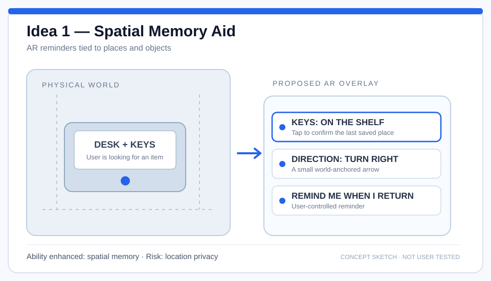
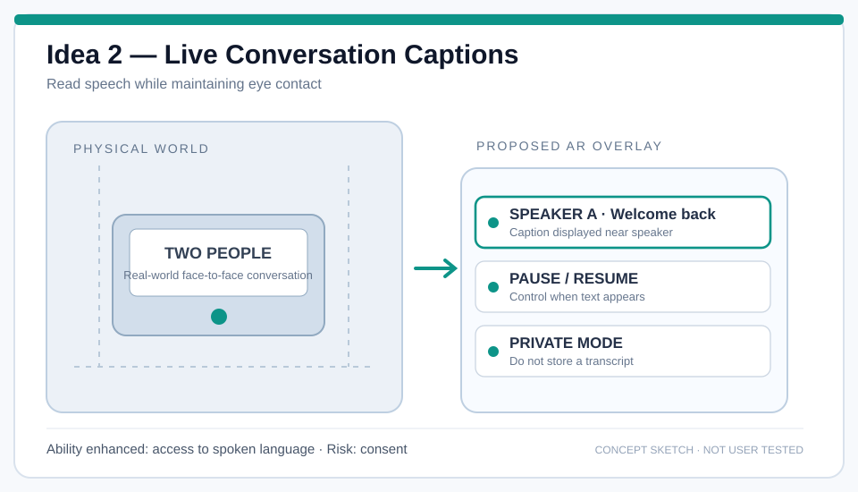
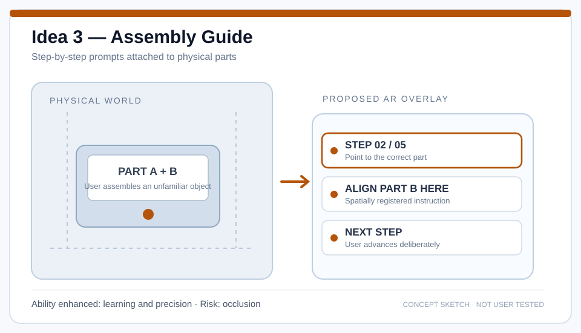
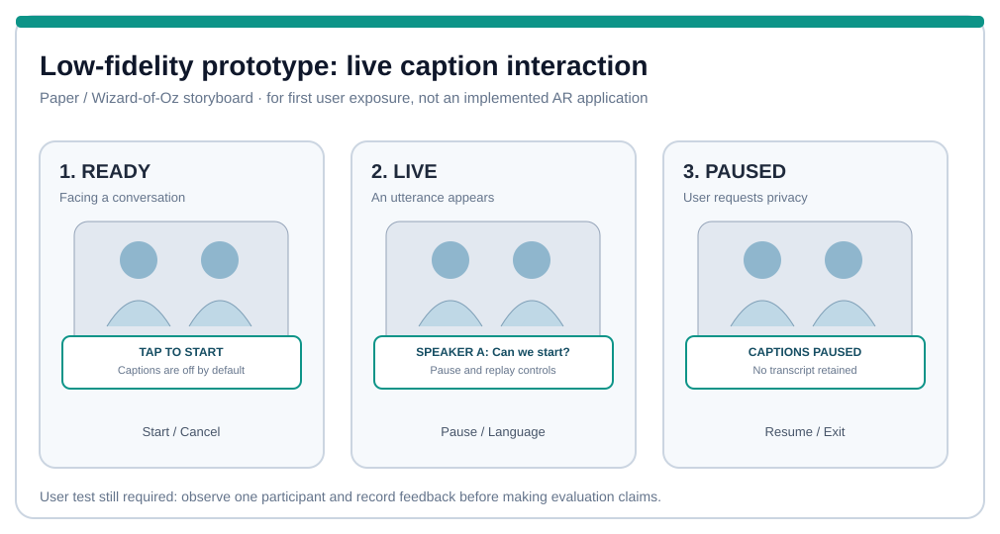

I wanted to explore one main question in this homework: **how can AR make something easier for a person, rather than just put more digital information in front of them?**

I started with three everyday difficulties: forgetting where something is, missing what another person says, and following unfamiliar instructions. I made a concept sketch for each one, compared what the user would actually do, and then developed one idea into an interactive prototype.

## Lecture 7 — Three AR ideas for everyday abilities

For the ideation part, I tried to keep each idea connected to a specific human ability. My three directions were **memory**, **communication**, and **learning by doing**. I also wanted each interface to be easy to turn off, because AR can become distracting if too much information stays in view.

### Idea 1 — Spatial Memory Aid

**Human ability: remembering and finding things.**

The first situation I chose was very ordinary: I put down my keys or a small tool and later cannot remember where I left it. I imagined AR glasses that could help me save a location and then give me a small reminder when I needed it.

I drew a simple desk-and-shelf scene with a saved object label and a direction hint. In my design, I would point at the object and confirm its location first. Later, the glasses could show something like “Keys: on the shelf” instead of asking me to search every corner of the room.

One decision I made was **not to save everything automatically**. I think that would create too much information and raise privacy questions. I would rather let the user choose what is important. The biggest technical difficulty would be keeping the location accurate if the object moved, so the interface should never act as if the remembered position is guaranteed to be correct.

### Idea 2 — Live Conversation Captions

**Human ability: understanding spoken conversation.**

My second idea came from situations where conversation becomes difficult to follow, such as a noisy café, a fast-speaking classmate, or a language that is not easy to understand. Looking at captions on a phone is possible, but it also means looking away from the person.

I sketched an AR caption that sits near the conversation instead of covering the middle of the view. I kept the text short and included a speaker label. I also added the idea of a clear pause control, because the user may want captions for one part of a conversation but not for everything.

As I thought through the design, I realised that **starting and stopping captions is just as important as displaying them**. If the user cannot tell whether the system is active, they may feel uncomfortable. Incorrect captions and other people's privacy are also concerns, so I wanted a visible listening state and a way to stop immediately.

### Idea 3 — AR Assembly Guide

**Human ability: learning and completing a physical task.**

For the third idea, I imagined someone assembling a small object for the first time. With a normal instruction sheet, it is easy to look from the paper to the object and then lose track of which part comes next.

I made a sketch that shows a physical part on one side and a short AR instruction on the other. The interface highlights one step at a time, suggests where the next piece belongs, and has **Next** and **Back** actions so the user can control the pace.

I liked the connection between the instruction and the actual object. However, I also noticed a problem with this idea: if the virtual outline does not line up with the real part, the guide could make the task harder or even lead to a mistake. A simple 2D instruction view would be a useful backup.

### How I chose the idea to develop

After drawing the three concepts, I compared what each one would need for a first prototype:

| Idea | What it helps with | Main design challenge |
| --- | --- | --- |
| Spatial Memory Aid | Remembering locations | Reliable position tracking |
| Live Conversation Captions | Following speech | Readability, status and privacy |
| Assembly Guide | Learning physical steps | Accurate alignment with objects |

I chose **Live Conversation Captions** because the main user actions are easy to explain and try out: turn captions on, read them, pause, and exit. I could explore those actions before trying to build a complete speech-recognition system or an actual headset application.

## Lecture 8 — From sketches to a caption prototype

Once I chose the caption idea, I stopped thinking only about what the glasses would display and started thinking about **what the user would do first, second, and third**.

I designed the interface around four controls: **Start captions**, **Next line**, **Pause / Resume**, and **Exit / Clear**. I used a dark, semi-transparent text panel so the words could stand out while the conversation remained visible behind them. A separate status label shows whether captions are off, live, or paused.

I also prepared a short simulated dialogue between two speakers. Instead of pretending the prototype can recognise speech, I made the **Next line** button reveal a prepared caption. This let me focus on the interaction: whether it is obvious when the system is running, and whether the user can stop it quickly.

### Interactive interface mockup

I built a small browser-based mockup of the proposed AR view. The buttons work, but the captions are example text rather than real microphone input.



### Low-fidelity storyboard

I also made a simpler three-frame version to show the basic flow: **Ready → Live → Paused**. This is useful because a person can try it with printed cards or on a screen without any special hardware.

The two prototypes serve different purposes. The interactive version makes it easier to try the controls, while the storyboard makes the idea easy to explain and adapt during a first user session. Neither version is a working AR headset or a tested speech-recognition system.

**One thing I learned while making the screens** is that the caption text itself is only half of the interface. The other half is giving the user enough feedback and control to feel comfortable using it.

## Lecture 9 — First Feedback and Reflection

I wanted to know whether my Live Captions idea would make sense to someone other than me, so I collected feedback on the prototype. The person I asked thought the function itself could be very useful. However, they also raised two problems that I had not considered carefully enough.

### Finding the right transparency

The first problem was the subtitle panel. I used a fairly dark, low-transparency background because I wanted the captions to be easy to read. The feedback pointed out that this panel still blocks part of the real-world view.

This made me think about a trade-off I had underestimated. If the background is too solid, it can hide a person's face or objects nearby. But if I make it almost invisible, the words may become difficult to read, especially against a busy background.

For the next version, I would try a **smaller caption box**, allow people to **move it to a different part of the view**, and provide a simple **opacity setting**. I would also limit the amount of text shown at once. My goal would be to keep the subtitles readable without making people feel that they are looking through a large digital window instead of at the real world.

### Making the idea easier for beginners

The second comment was about learning how to use the glasses. AR subtitles might seem natural to someone familiar with digital interfaces, but people who do not often use smart devices could find the experience confusing at first.

I originally thought that Start, Pause, and Exit were simple enough. After hearing this feedback, I realised that the buttons alone do not explain everything. A new user also needs to understand **when captions are active**, what will appear in their view, and how to stop them whenever they want.

I would add a short first-use guide with three clear steps: **Start captions → Read the subtitles → Pause or Exit**. A small example conversation could help people try the controls before using them during a real conversation.

### What I learned from the feedback

Before this, I was mainly thinking about whether the idea was useful and whether the words were readable. The feedback reminded me that **comfort and accessibility are also part of the interaction design**. A feature can be helpful in theory but still feel distracting or hard to learn.

I have not changed the current mockup based on these comments yet. The next design iteration would focus on caption placement, background opacity, and a clearer introduction. I would then want to get feedback on that revised version to see whether the changes actually help.

## Reflection on the design so far

These three concepts made me think of AR less as a futuristic display and more as a way to support specific human abilities. A memory reminder, a caption, and an assembly instruction are very different, but they all have to respect what the person is already doing in the real world.

For my chosen caption prototype, I first focused on **visibility, readability and user control**. The feedback made me realise that I also need to think about how much of the real world the panel hides and how a first-time user learns the controls. Those are the improvements I would prioritise next.
