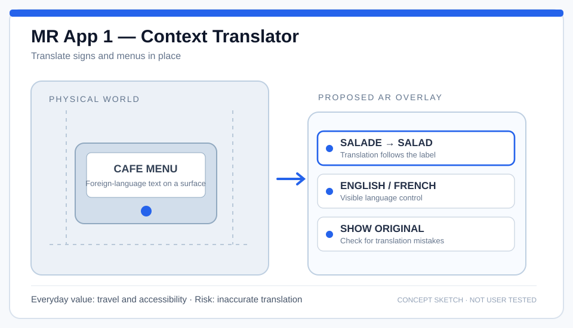
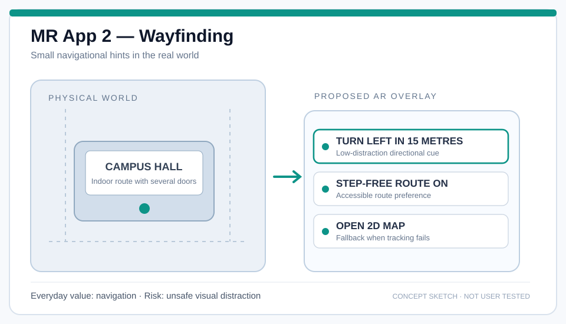
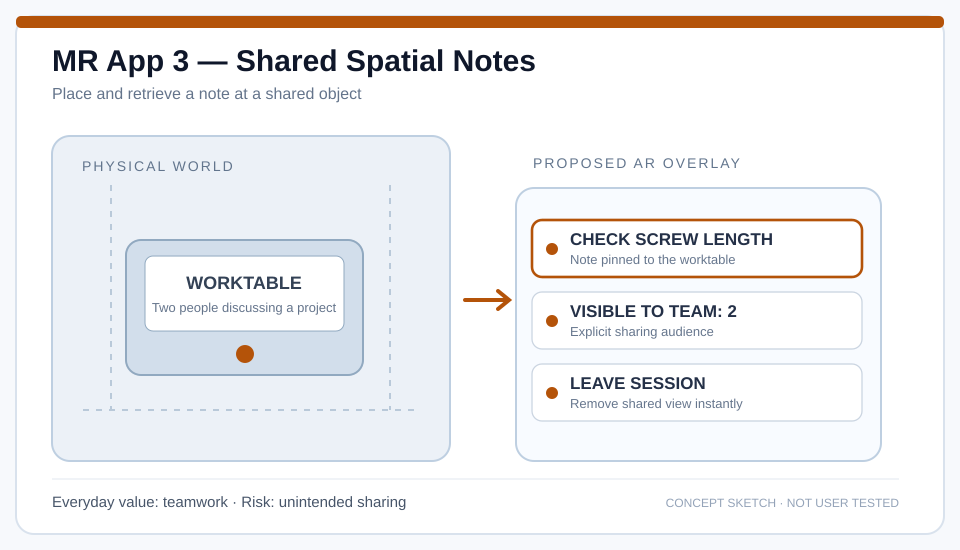

> **Work status:** Written responses to Lectures 10 and 11 and three illustrated concepts for Lecture 12 have been prepared. The opinions and future predictions should be reviewed and personalised before submission. No user study or hardware test is claimed.

## Assignment requirements

- **Lecture 10 — The shape of smartphones (5 points):** discuss how and why smartphone shapes evolved, predict the next change, and explain the reasoning.
- **Lecture 11 — The Computer for the 21st Century (5 points):** read Mark Weiser's paper and discuss whether ubiquitous computing is already here, what has happened, and what is still missing.
- **Lecture 12 — Future MR application store (5 points):** imagine MR head-mounted displays as common as smartphones; **sketch and present three applications** likely to be among the most downloaded, explaining why.

[Source: HW4.pdf](https://drive.google.com/file/d/1STXCI1kTbvfDgb2G3F-Jr6HhTUyaz5BX/view)

## Lecture 10 — Why smartphones changed shape, and what may come next

### A change from a device with keys to a programmable surface

Earlier mobile phones needed dedicated physical controls for entering numbers, navigating menus and sending messages. Their shapes often reflected those tasks: keypads, small displays, and sometimes sliding or folding bodies. The space devoted to buttons also limited how much information could appear at once.

Modern touchscreen phones changed the trade-off. A screen can become a keyboard, a map, a camera viewfinder, a video player or a game interface depending on the application. Apple's 2007 iPhone is an influential example of combining a phone, internet device and touch-controlled media player in a predominantly display-based design. Removing much of the dedicated keypad made the same surface useful for many different actions.

The next visible change was a larger display relative to the body. The 2017 iPhone X illustrates the move toward an almost all-screen front. Buttons did not disappear entirely, but a growing share of interaction moved to gestures, touch targets and on-screen feedback.

These changes were not only about appearance. A large display supports reading, photography, navigation and video, while keeping the phone thin and light enough to carry. Yet this creates another problem: a bigger screen is useful, but a bigger rigid object is less comfortable in a pocket or in one hand.

### Folding as an attempt to resolve the conflict

Foldable phones address the conflict between **portability** and **display area**. Samsung's Galaxy Fold, announced in 2019, offered a compact closed form and a larger display when opened. Opening the device changes both its shape and the interaction layout: a quick one-handed check can turn into reading or multitasking on a larger canvas.

I would describe this as an HCI trade-off, not a clear victory for one shape. Folding introduces a hinge, thickness, an unfolding action, durability questions, higher costs, and software that must adapt when the available screen changes. A design can offer more screen space while also making some common actions less convenient.

### My proposed next step: adaptive form, not one universal shape

A plausible next step is **a family of context-adaptive form factors** rather than every phone becoming the same folding object. Some people may prefer a compact slab for fast, one-handed use; others may value a device that opens for documents or creative work; still others may move occasional information to a watch or lightweight MR display.

Three forces support this prediction:

1. **Different tasks demand different surfaces.** Glancing at a notification is not the same activity as editing a document. One fixed shape is unlikely to optimise both.
2. **Physical constraints remain.** Weight, battery, durability, heat, cost and grip still matter even as screens change.
3. **Interaction may extend beyond the phone.** Voice, cameras, wearables and spatial displays can support some tasks without requiring an ever-larger handheld screen.

The alternative prediction is that the simple rigid smartphone stays dominant because it is familiar, durable and relatively affordable. Foldables and wearables could remain specialised options. I think this is an important counterargument: **technological feasibility does not automatically produce widespread adoption**.

**Conclusion:** smartphone shapes have evolved in response to a continuing tension between screen usefulness and physical convenience. The next successful form will be the one that reduces friction in everyday tasks, not simply the one with the most unusual hinge.

### References for Lecture 10

- [Apple, “iPhone at ten” (2017)](https://www.apple.com/newsroom/2017/01/iphone-at-ten-the-revolution-continues/) — retrospective on the 2007 iPhone.
- [Apple, “The future is here: iPhone X” (2017)](https://www.apple.com/newsroom/2017/09/the-future-is-here-iphone-x/) — all-screen front and changing interaction.
- [Samsung, “Introducing Galaxy Fold” (2019)](https://news.samsung.com/global/samsung-unfolds-the-future-with-a-whole-new-mobile-category-introducing-galaxy-fold) — foldable phone design and multitasking.

## Lecture 11 — Are we already living with ubiquitous computing?

Mark Weiser's 1991 paper **The Computer for the 21st Century** does not simply predict that computers will become smaller or more portable. Its main argument is more demanding: computing should become integrated into ordinary environments so that people can concentrate on the activity rather than the computer itself.

Weiser discusses three rough scales of interconnected devices:

| Weiser's category | Original role | Contemporary comparison |
| --- | --- | --- |
| **Tabs** | Small tags, badges and contextual reminders | Wearables, tags and context-aware small devices |
| **Pads** | Portable, task-specific sheets that could be picked up and shared | Tablets, e-readers and some shared touch surfaces |
| **Boards** | Large displays for discussion and shared work | Interactive whiteboards and connected shared screens |

The comparisons are imperfect: for example, Weiser's imagined pads were interchangeable “scrap computers”, not necessarily precious personal tablets. His core vision depends on **location, different physical scales, networking and low-effort integration**, not on counting devices per household.

### What has already happened?

**First, many computers have moved into everyday objects.** Watches, thermostats, household appliances, access-control devices and wireless tags can contain computing functions without resembling a conventional desktop computer.

**Second, wireless networking makes context-sharing possible.** Phones, headphones, computers, displays and sensors can exchange information automatically, enabling experiences that would have been difficult when each device was isolated.

**Third, computing is available at more than one physical scale.** People move between small wearable devices, handheld screens and large displays throughout a day.

These developments resemble parts of Weiser's vision. In that sense, **we already live in a partially ubiquitous computing environment**.

### Why the vision is still incomplete

However, having many connected products is not the same as experiencing invisible, calm computing.

- **Attention cost.** Notifications, permissions, repeated authentication and incompatible interfaces frequently demand attention rather than receding into the background.
- **Interoperability.** Devices from different ecosystems may not cooperate reliably. A person still often has to move files or recreate context manually.
- **Privacy and consent.** A context-aware room may need to know who is present, but collecting and sharing that information creates surveillance risks. Weiser's own example of location-aware badges is useful precisely because it makes this tension visible.
- **Reliability and accessibility.** An automated action must be understandable, reversible and safe when the network fails or a person cannot use a particular input method.
- **Environmental cost.** Hundreds of connected devices per room would also have consequences for batteries, energy use, repairability and electronic waste.

### What needs to happen next?

I think ubiquitous computing will be closer to Weiser's ideal when devices can exchange context with **explicit permissions**, surface information only when it is useful, and offer simple ways to inspect, correct and reverse automatic actions.

For example, a shared workspace might recognise that a meeting has begun and show the right documents on a board. That sounds convenient, but the participants must also know which information is being shared, who can see it, and how to stop it. Without those controls, the system may be connected but not human-centred.

**My answer is therefore: partly yes, but not completely.** Computing is everywhere in a technical sense. Weiser's deeper goal—a calm environment in which technology supports activity without constantly becoming the activity—is still unfinished.

### Reading for Lecture 11

- [Mark Weiser, *The Computer for the 21st Century* (Scientific American, September 1991)](https://www.lri.fr/~mbl/Stanford/CS477/papers/Weiser-SciAm.pdf) — the paper required in the homework brief.

## Lecture 12 — Three applications for a future MR app store

The task assumes a future in which mixed-reality head-mounted displays (MR HMDs) are as common as smartphones. In that setting, I would not expect the most-downloaded applications to be only spectacular 3D games. Everyday applications may reach more people because they solve frequent, concrete problems with little setup.

The following are **speculative app concepts**, not predictions supported by sales data. Each is shown with a concept sketch and a reason it could be widely adopted.

### Application 1: Context Translator

**What it does.** Translates signs, menus, labels and brief notices directly where they appear, without forcing the user to switch to a handheld camera view. The original text remains accessible so users can compare it with the translation.

**Example interaction.** A traveller looks at a restaurant menu, sees a concise translated label, switches languages with a visible control, and hides the overlay when they no longer need it.

**Why it might be widely downloaded.** Language barriers appear in travel, study, shopping and everyday public spaces. The value is immediate and understandable, without requiring users to learn a complicated 3D interaction technique.

**HCI concern.** A confident but incorrect translation can mislead someone, especially about food allergies, directions or safety warnings. The design should make uncertainty visible and support quick access to the original wording.

### Application 2: Everyday Wayfinding

**What it does.** Provides short, spatially aligned cues for navigating campuses, transport hubs, unfamiliar buildings and streets. The interface prioritises simple, optional hints rather than a constant floating map.

**Example interaction.** The user asks for a classroom, chooses a step-free route, and sees a small left-turn prompt at the next corridor. A conventional 2D map is available if tracking is lost.

**Why it might be widely downloaded.** Finding places is a recurring need across many ages and occupations. A feature that supports both outdoor and complex indoor routes could become an everyday utility rather than a special-interest demonstration.

**HCI concern.** Guidance must not cover hazards or create false confidence. Location uncertainty, accessibility requirements and failures of indoor positioning must be handled explicitly.

### Application 3: Shared Spatial Notes

**What it does.** Allows people to pin small notes or annotations to a shared real-world object: a workbench, meeting board, lab apparatus or classroom model. Another authorised participant can see the note in the same place.

**Example interaction.** Two students inspect a model. One adds “Check screw length” to a component; the other sees the note at the component rather than searching through a message thread. An audience indicator shows who can see it.

**Why it might be widely downloaded.** Collaborative work and communication happen every day. The application could make spatial discussions more efficient when location is meaningful and a plain message does not adequately identify an object.

**HCI concern.** Shared notes need clear ownership, visibility controls and robust registration. A private annotation must not accidentally become visible to everyone in the room.

### Why these three, rather than one universal “killer app”?

| Candidate | Frequent need | Unique reason to use MR | Main risk |
| --- | --- | --- | --- |
| Context Translator | Understanding nearby text | Keeps translated labels attached to what they describe | Incorrect translation |
| Everyday Wayfinding | Finding places | Aligns a direction cue with the real corridor or street | Distraction or inaccurate tracking |
| Shared Spatial Notes | Working with other people | Connects discussion to a physical location or object | Unwanted sharing |

All three have a **short time to value**: the user can understand the purpose within seconds. They also fit the assumption of ubiquitous MR because the headset would already be worn, making it easier to consult context without taking out another device.

I expect successful MR apps to compete on readability, trust, accessibility, privacy and low-friction interaction—not merely the number of virtual objects they can display.

## Submission review

- [x] Lecture 10: explain previous form-factor changes, why they happened, a possible next step and the reasoning behind it.
- [x] Lecture 11: analyse Weiser's paper; discuss what exists and what remains missing.
- [x] Lecture 12: describe and **sketch three apps**, explain why each could be widely downloaded.
- [ ] Review and personalise the forecasts and preferences before submitting this written draft.
