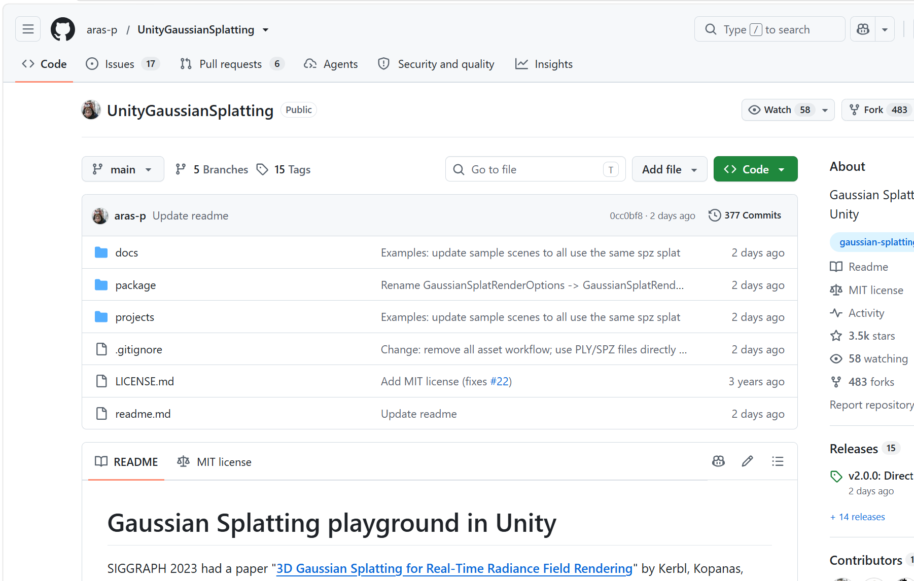
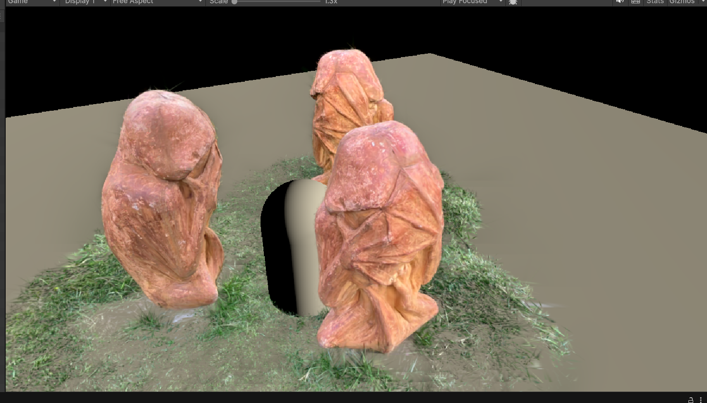
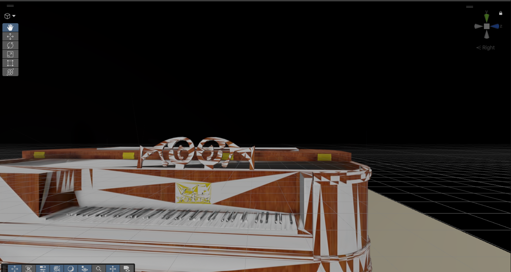
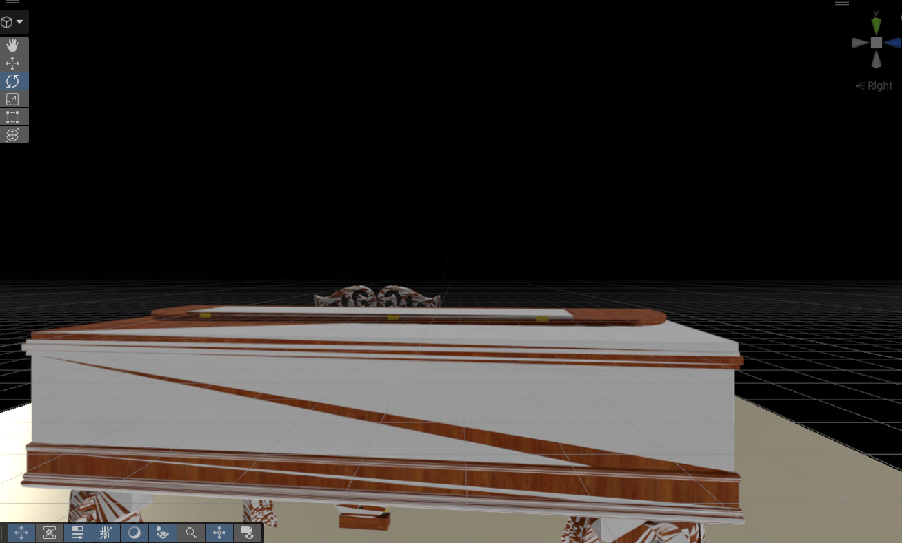
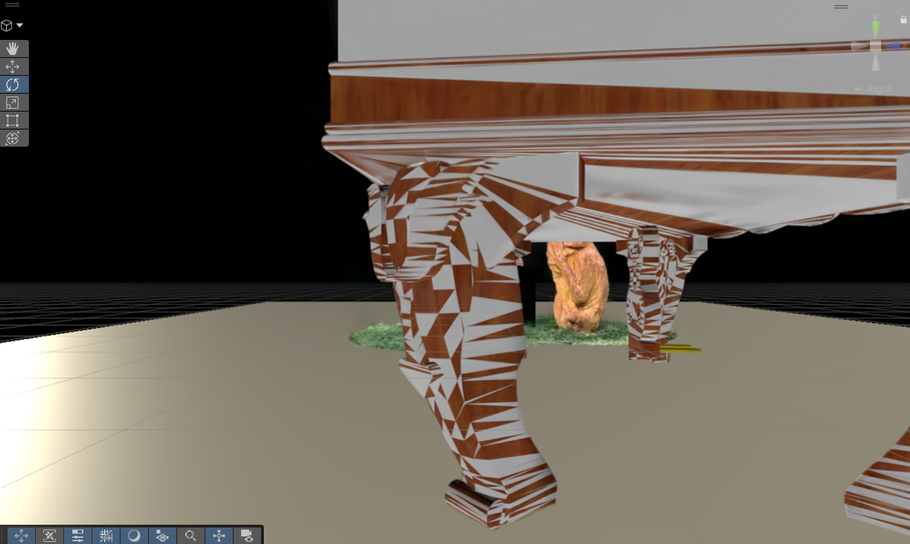

## Goal

The goal of this lab was to take a **trained 3D Gaussian Splatting (3DGS) scene** and display it in **Unity**. Unlike a conventional triangle mesh, 3DGS represents a scene using many small 3D Gaussians with positions, shapes, colors, and opacity. These are projected and blended to form an image from the current camera viewpoint.

I used a **piano scene** for this lab. My work covered the trained PLY results, bringing a Gaussian Splatting renderer into Unity, and checking how the reconstruction looked from several viewpoints. For an interactive application, successfully loading a scene is only the first step: the result also needs to be visually readable when the camera moves.

## Trained piano model

The training output is saved in Google Drive under **piano-400-oGS**. It contains camera data and two point-cloud checkpoints:

| Training output | Saved file | Size |
| --- | --- | ---: |
| **7,000 iterations** | [point_cloud_1.ply](https://drive.google.com/file/d/17bkHqIRUOdgGafX77-0v_myq2tgl2cZ1/view) | 79.4 MB |
| **30,000 iterations** | [point_cloud.ply](https://drive.google.com/file/d/1wUPC9oai35NRFtFoLWZPQYfTz2WIoWNp/view) | 99.5 MB |

The folder also includes **input.ply**, **cameras.json**, and **cfg_args**. The initial input point cloud and the trained Gaussian checkpoints serve different purposes, so I used the trained point-cloud output for the Unity workflow rather than treating input.ply as the final result.

The 30,000-iteration PLY is the final checkpoint I kept for this lab, while the 7,000-iteration file is preserved as an earlier result. The two checkpoints were not used here for a quantitative image-quality comparison.

## Importing 3DGS into Unity

I used the open-source [UnityGaussianSplatting](https://github.com/aras-p/UnityGaussianSplatting) project by **Aras Pranckevičius** and opened its **GaussianExample** project in **Unity 6**. The Unity setup shown during this lab was **6000.6.5f1**, using **Vulkan** on Windows.

The instructor's slides demonstrate an older workflow using **Tools → Gaussian Splats → Create GaussianSplatAsset**. That menu was missing in my downloaded version. The reason was a change in **UnityGaussianSplatting v2.0.0**: the current renderer reads Gaussian-splat **PLY/SPZ files directly**, without a separate Create Asset conversion step.

My Unity workflow was:

1. Open **projects/GaussianExample** and its **GSTestScene**.
2. Check that the example splats can render in Unity with Vulkan.
3. Place a trained piano PLY in **Assets/StreamingAssets**, or point the renderer to its file path.
4. Add a **GaussianSplatRenderer** component to a GameObject and set its **PLY / SPZ** field to the piano file.
5. Move the camera around the imported scene to inspect the reconstruction.

The example scene helped me check that the renderer was working before testing my own model.

## Result: piano displayed from multiple viewpoints

After the import, the piano was visible in the scene. I captured several views to examine the recognizable parts of the reconstruction, including the **keyboard, wooden body, top details, and legs**.

The screenshots demonstrate that the piano can be explored from different camera positions rather than remaining a single fixed image. The overall form is recognizable, but the current views also show **large white triangular or striped patches on parts of the surface**, especially around the body and legs. I therefore consider the Unity import successful as a working scene, while the visual quality still needs refinement.

## What I learned and what I would improve

Two points stood out during this lab.

**First, software versions change the practical workflow.** I initially looked for the Create GaussianSplatAsset menu shown in the teaching slides, but the newer renderer removed it. Reading the updated project documentation made the process simpler: use the original trained PLY directly with GaussianSplatRenderer.

**Second, a successful import is not necessarily a clean reconstruction.** The piano's shape is visible, but the white surface artifacts make some parts harder to interpret. I would next check the PLY properties and renderer settings, revisit the camera orientation and scale, and compare the rendered result with the original trained-model viewer before deciding where the artifacts originate.

From an HCI perspective, viewpoint control is useful because it lets a person inspect a reconstructed object interactively. However, **visual artifacts can reduce the clarity of what the user is seeing**, so rendering quality matters just as much as getting the data into the engine.

Overall, I completed the pipeline from a saved Gaussian Splatting model to a viewable Unity scene. The next step is to improve rendering fidelity and make the piano easier to explore.

## Project files and references

- [Lab_3DGS Google Drive folder — screenshots and trained outputs](https://drive.google.com/drive/folders/1lrGgC2YtkvEBlbq5mNsBt8xztzcYkh5Z)
- [Final 30,000-iteration piano PLY](https://drive.google.com/file/d/1wUPC9oai35NRFtFoLWZPQYfTz2WIoWNp/view)
- [7,000-iteration piano PLY](https://drive.google.com/file/d/17bkHqIRUOdgGafX77-0v_myq2tgl2cZ1/view)
- [Course slides: 3D Gaussian Splatting in Unity](https://docs.google.com/presentation/d/10c4HqrMO-ywF9clEW_SeF3u1L6tvhdX3/edit)
- [UnityGaussianSplatting repository](https://github.com/aras-p/UnityGaussianSplatting)
- [UnityGaussianSplatting v2.0.0 release notes](https://github.com/aras-p/UnityGaussianSplatting/releases/tag/v2.0.0)
