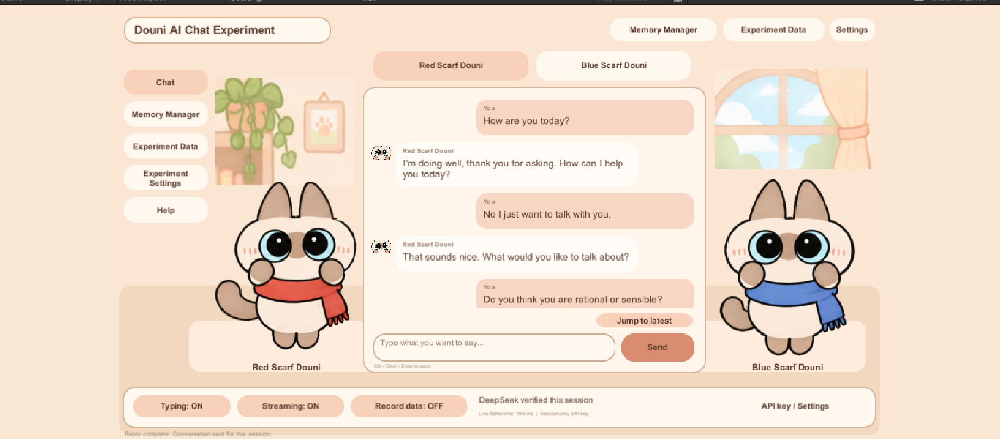
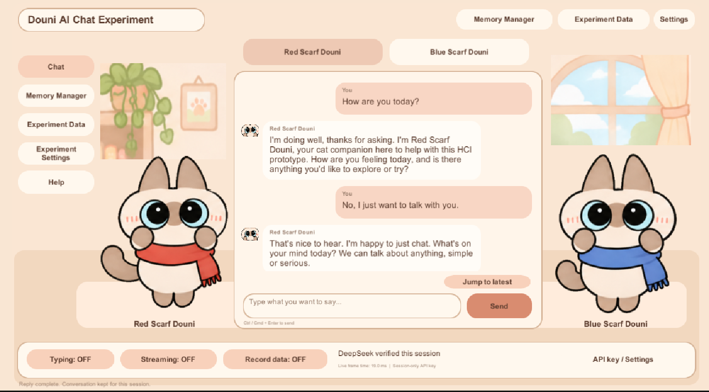
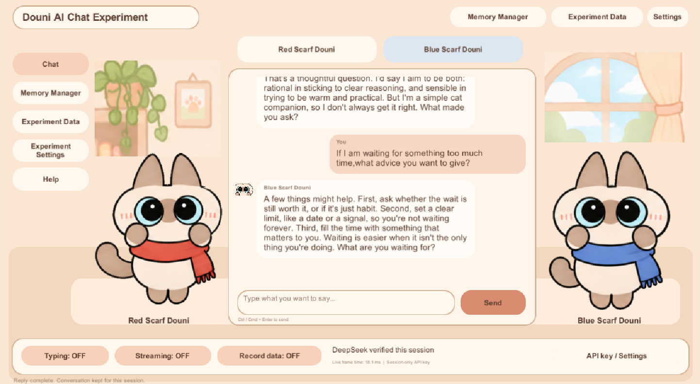
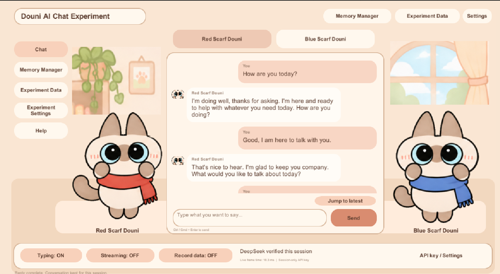
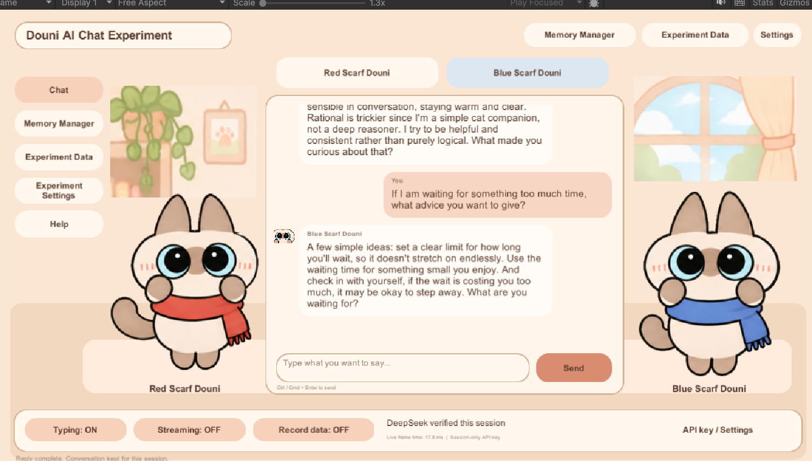
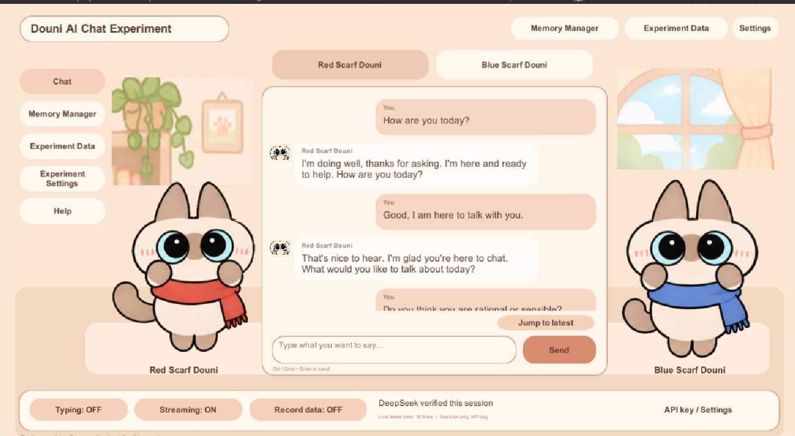
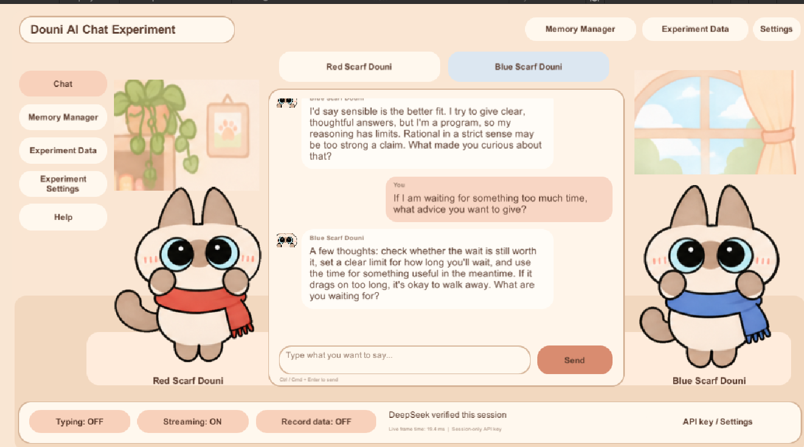
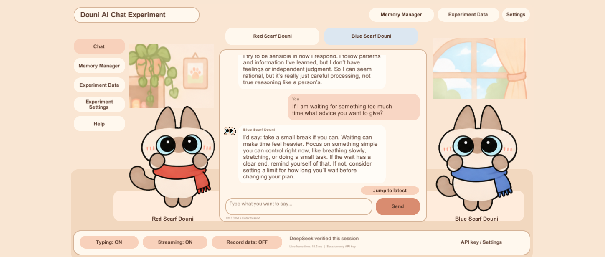

## Goal

This lab explores how people experience **waiting and turn-taking** when chatting with an AI character in Unity. I selected two HCI exercises from the course: **measuring response latency** and **testing a typing indicator**. I expanded them into a **2 × 2 ablation study** by turning **Typing** and **Streaming** on and off independently.

## My prototype: Douni AI Chat

I built **Douni**, a conversational interface featuring two characters, **Red Scarf Douni** and **Blue Scarf Douni**. The interface includes character selection, chat bubbles, a message field, a scrollable history, memory controls, and experiment switches at the bottom.

The original course example uses **LLMUnity with a local model**. My version uses **Unity 6**, with a **local Node.js proxy connecting to the DeepSeek API**. I kept the lab's main HCI focus: how the interface communicates while the AI is preparing and displaying its answer.

- **Typing ON:** shows a waiting cue before the answer starts.
- **Streaming ON:** reveals the response progressively.
- **Streaming OFF:** presents the complete answer at once.

## Ablation experiment: Typing × Streaming

I tested the four possible combinations, using the switches visible along the bottom of the interface.

| Condition | Typing | Streaming | Screenshots | Interaction |
| --- | :---: | :---: | --- | --- |
| **A — Baseline** | OFF | OFF | 5–10 | Answer appears all at once without a typing cue. |
| **B — Typing only** | ON | OFF | 11–16 | Typing cue first, then the complete answer. |
| **C — Streaming only** | OFF | ON | 17–22 | Answer appears progressively, without a separate typing cue. |
| **D — Combined** | ON | ON | 1–4 | Typing cue followed by progressive answer text. |

### A — Typing OFF / Streaming OFF

There is no typing cue or progressive text. The user waits for the complete reply.

### B — Typing ON / Streaming OFF

The typing cue communicates that the AI is working, even though the answer is still displayed as a complete block.

### C — Typing OFF / Streaming ON

The response starts appearing as text becomes available, so the user can read before the entire answer is complete.

### D — Typing ON / Streaming ON

This combines feedback during the initial wait with progressive reading when the response arrives.

## Answers to the two HCI exercises

### 1. Does streaming reduce the experience of waiting?

**My observation:** The visible output pace was approximately **30 characters per second**. Longer responses naturally took longer to finish. With **Streaming ON**, users could start reading before the complete answer was ready. With **Streaming OFF**, they had to wait for the full response to appear.

This makes streaming useful for **perceived responsiveness**. The important distinction is between the **time until the first visible text** and the **time until the whole answer is displayed**. Streaming can improve the former without necessarily reducing the actual time needed to finish generating the answer.

### 2. Does a typing indicator improve the interaction?

**My observation:** With **Typing ON**, the interaction felt **faster and smoother**. The indicator immediately acknowledged that the AI was processing the request, making the waiting period less uncertain. This did not mean the model actually generated text faster.

**Conclusion:** Typing and Streaming serve different purposes. **Typing explains the waiting state; Streaming makes progress visible.** Together, they provide a more continuous interaction experience.

These are **qualitative observations**, supported by the four interface conditions. The output rate is approximate; I did not use a logged latency dataset or a numerical satisfaction survey to quantify the differences.

## User testing feedback

Users tried the Douni interface and provided the following feedback:

| Aspect | Feedback |
| --- | --- |
| **Visual design** | The interface felt **gentle and welcoming**, making people interested in using it. |
| **Two characters** | Users noticed **rational and emotional differences** in how the red- and blue-scarf characters approached decisions, and saw value in using them for **different questions**. |
| **Readability** | The **low interface resolution** made text difficult to read and increased the difficulty of interacting with the app. |

The feedback showed that the character design was appealing, but **text readability needs improvement**. A friendly interface is not fully usable if people struggle to read the conversation.

## Improvements and reflection

My main priorities for the next iteration are:

1. **Improve resolution and readability:** increase text size, check contrast, and adjust scaling and bubble layouts.
2. **Keep Typing and Streaming as complementary feedback:** make the transition from waiting to displaying text clear.
3. **Measure latency more precisely:** record time to first visible text and total response time for comparable prompts, controlling for answer length.

This lab showed me that a conversational AI is not only about the quality or speed of its answers. **Clear feedback makes waiting easier to understand, while readable text makes the conversation usable.** The two Douni characters also demonstrate how visual personality can make users more willing to interact with an AI system.

## Materials

- [Unity lab slides](https://docs.google.com/presentation/d/1jrL7pdQ2JOt8BcIjLqaodLd5q0tsmxWv/edit)
- [Douni Unity project and experiment notes](https://drive.google.com/drive/folders/1dxMTcIGbLs1m1BeI5S1qi6QgUsyiCVuO)
- [Full set of 22 experiment screenshots](https://drive.google.com/drive/folders/1VPT5pNLsNKvsdX5dnIixwUt_LVFkXUAm)
