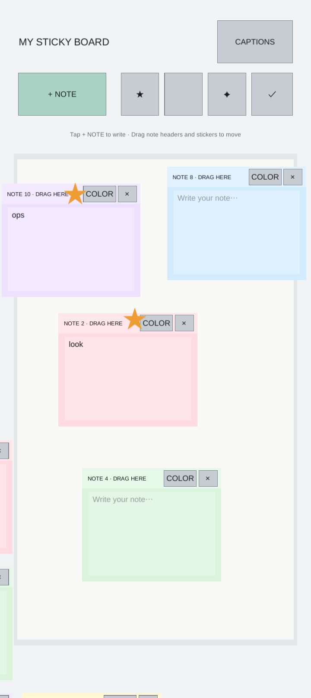
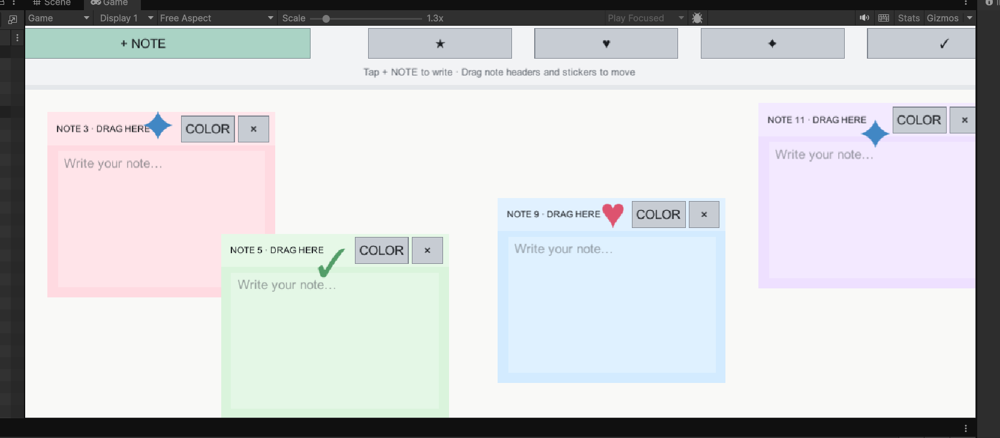
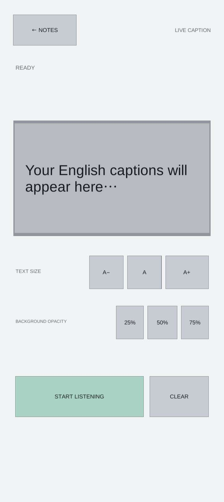
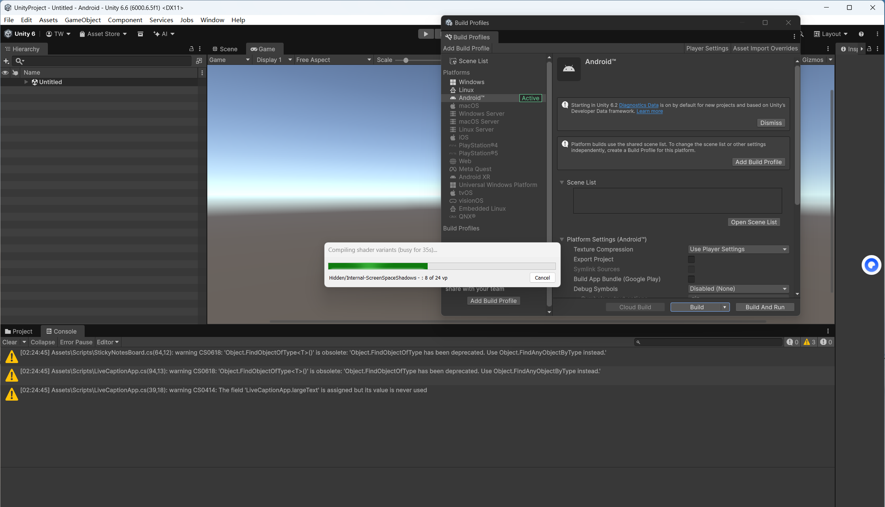

## Goal

The goal of this lab was to adapt an application concept for a mobile phone, choose an interaction method that makes sense on a touch device, deploy an Android test, and document the process. The lab brief makes an important point: an interaction that works on a desktop does not necessarily work well on a phone.

For this project, I explored how **live captions and personal notes could support students during a class**. Captions help a student follow what is being said, while notes provide a place to keep important terms, reminders, and explanations. I used Unity 6 for the mobile interface and kept Android speech recognition behind a native Java bridge.

- [Source code: LiveCaption on GitHub](https://github.com/WanY864/LiveCaption)
- [Lab brief: Lab2_mobile](https://docs.google.com/presentation/d/1TruBrUP1dIFdn0hm-YuQX9dbdi2epJ2Q/edit)

## Why combine captions and notes?

I initially focused on an English-only live-caption interface. Thinking about the classroom scenario made me realise that showing the spoken words is only part of the problem. A student may follow a sentence in real time but still want to save a definition, a question, or a key point for later.

My main evaluation is that **combining notes and captions has the greatest potential to improve the classroom experience**, especially for students whose first language is different from the language used in the lecture. Captions can make spoken information easier to follow in the moment; notes let students preserve the information they want to review afterwards.

This is a qualitative design evaluation based on the classroom scenario and my prototype experience, not a claim based on a large or statistically controlled user study. A formal study with participants and comprehension measures would be a useful next step.

## Design: two modes in one mobile app

I separated the app into two modes so that each task has a clear space:

- **Sticky Board** is the primary mode for writing and organising information.
- **Live Captions** remains an optional mode for devices that provide a compatible Android speech-recognition service.

### Sticky Board

The note board uses direct touch interaction. A user can create a note, tap its body to type, drag its header to move it, and change its colour. The toolbar also provides decorative stickers.

The note cards are intended to behave like small pieces of paper on a shared canvas. The header is a dedicated drag handle, leaving the main body available for text input. This separates two actions that could otherwise conflict: editing the note and moving it.

### Live Captions

The second mode keeps the original caption interface. It has a two-line caption area, text-size controls, background-opacity controls, and start/pause and clear actions.

The caption screen is still useful as an interface and integration point, but its actual recognition capability depends on the Android device. A visible caption panel alone does not mean that speech recognition is available.

## Implementation in Unity

I used Unity's UGUI system to create the interface at runtime. The main Canvas uses **Screen Space – Overlay** and a **Canvas Scaler** with a reference resolution of 1080 × 1920. This provides a consistent starting coordinate system for a portrait mobile interface.

The Sticky Board implementation includes:

- A multiline input field for each note.
- A drag handler on the note header, using Unity's pointer drag interfaces.
- A colour-cycle action for each note.
- Sticker elements that can be dragged independently.
- A local JSON save file for note text, colour, position, sticker type, and sticker position.

The note data is written under Unity's persistent data directory, in a file named **livecaption_sticky_board.json**. This keeps the notes on the device and does not require an account, cloud service, or network connection.

The main implementation is in **UnityProject/Assets/Scripts/StickyNotesBoard.cs**. The Unity bootstrap starts the Sticky Board as the default interface. The original speech-recognition bridge remains in the Android plugin folder.

### Keeping the speech-recognition interface

I retained the Android Java SpeechRecognizer bridge rather than removing it. It requests English (en-US) recognition and can pass partial recognition results back to the Unity interface when the Android provider supports them.

The bridge is optional. Microphone permission is requested only when the user starts listening. The note-taking mode does not depend on microphone access.

## Android setup and deployment

I used **Unity 6.6.5f1** with Android Build Support. The Android build was configured for a phone, using the Unity-provided JDK, SDK, and NDK.

I also prepared a test APK named **CaptionNote.apk** in the Lab_mobile materials. The build process exposed several problems that are worth documenting because they are easy to overlook when following a Unity Android tutorial.

### Problems encountered and how I approached them

**1. Missing Unity UI types**

The first project import reported missing Unity UI and EventSystem types. The project needed the UGUI package dependency before the interface scripts could compile.

**2. Built-in font compatibility**

Unity 6 reported that Arial.ttf was no longer a valid built-in font resource. I changed the runtime UI to use LegacyRuntime.ttf.

**3. Gradle installation versus Gradle cache**

I initially moved the Gradle installation to C:\gradle. This made it important to distinguish the Gradle program itself from the Gradle user cache. I then configured the Gradle user home as C:\UnityGradleHome and returned to Unity's bundled build tools.

**4. CMake / Prefab failure**

A later Android build log failed at the ARM64 task named configureCMakeRelWithDebInfo. The failing stage was preparing the games-frame-pacing-2.1.2 Prefab package. The log also showed that Windows TEMP and TMP still pointed to a path containing the Chinese Windows user-folder name. Moving the Gradle cache alone did not resolve this failure.

These problems taught me to separate Unity script compilation from the Android native build pipeline. A project can compile its C# scripts and still fail later when Gradle, CMake, Prefab, the SDK, or the NDK are invoked.

The APK in the lab folder is a test artifact, but the later CMake / Prefab failures mean that I do not yet consider the latest source-to-APK build fully reproducible. The final Android build should be checked again after the build environment is stable.

## Evaluation and limitations

### 1. Notes and captions are most useful together in a classroom

The strongest part of the concept is the combination of listening support and personal note-taking. Captions provide immediate access to spoken information, while notes let students capture key ideas in their own words. This combination seems particularly valuable for students whose native language differs from the lecture language.

However, the current caption mode only recognises English. It does not automatically translate the lecture into another language, so the benefit for multilingual students is limited when they need translation rather than transcription.

### 2. Note positions are not consistent across devices

I noticed that notes and newly added components do not always appear in consistent positions on different devices. A layout that looks acceptable in one Unity Game view can shift or become crowded on a phone with a different aspect ratio or usable screen area.

The current prototype uses a Canvas Scaler, but some note positions are still assigned with fixed anchored offsets. That is not enough to guarantee consistent placement across all screens. The next iteration should use normalised or layout-driven positions, respect Android safe areas, constrain dragged notes to the board, and test the same set of notes on multiple screen sizes.

### 3. Captions need translation support

The caption interface is less useful on mobile devices that do not provide a local translation feature. I would like to add a **built-in translation model** so that a student can choose a target language while keeping the original English caption available for reference.

There are two separate technical stages:

1. Speech-to-text converts the speaker's audio into English text.
2. A translation model converts that text into the selected language.

A translation model cannot translate speech that has not first been converted into text. If a device has no compatible speech-recognition service, a fully offline version would also need an on-device speech-to-text model. Model size, memory use, battery consumption, and latency would all need to be tested on the target phone.

### 4. Device compatibility

On my **vivo Y37**, the app did not have access to a usable Android speech-recognition service. The caption interface and Java bridge remain in the project, but I could not validate live transcription on this phone. This is a limitation of the current device/provider setup, not proof that the interface itself is unusable on every Android phone.

The Sticky Board does not depend on speech recognition and remains the main usable interaction when no recognition service is available.

## Summary of findings

| Area | What the prototype provides | Current limitation |
| --- | --- | --- |
| Classroom support | Combines live information with personal notes | Translation is not built in |
| Note taking | Create, edit, recolour, and move notes | Positioning is not consistent across devices yet |
| Stickers | Add and move decorative stickers | Placement needs stronger board boundaries |
| Captions | English caption UI and retained Android bridge | Requires a compatible speech-recognition service |
| Data | Local JSON persistence | No cloud backup or synchronisation |
| Deployment | Unity Android project and a test APK artifact | Latest source build still needs a clean, reproducible Android build |

## Future improvements

I would prioritise four improvements:

1. **Responsive note layout:** use normalised positions, safe-area-aware layout, and board-boundary constraints so that notes remain predictable on different phones.
2. **Built-in translation:** add a selectable target language and an on-device translation model, while keeping the original English caption visible for checking.
3. **Speech-to-text fallback:** investigate an on-device speech-recognition model for phones without a system recognition provider. This would need careful testing for model size, memory, latency, and battery use.
4. **Classroom-focused evaluation:** test the combined note-and-caption workflow with students whose first languages differ from the lecture language. Measure task completion, comprehension, note usefulness, and perceived effort rather than relying only on impressions.

## Reflection

This lab changed how I think about a mobile classroom tool. At first, I treated captions as the main feature. After considering the actual classroom situation, I found that **captions and notes are more useful as complementary tools**: one supports following the lecture, and the other supports remembering and reviewing it.

The main lesson from implementation is that mobile interaction needs more than shrinking a desktop interface. Touch targets, dragging, text entry, safe areas, screen proportions, and device services all affect whether the app works in practice. The prototype now has a clear direction, but responsive placement and multilingual speech support are the two areas I would address before treating it as a finished classroom tool.
