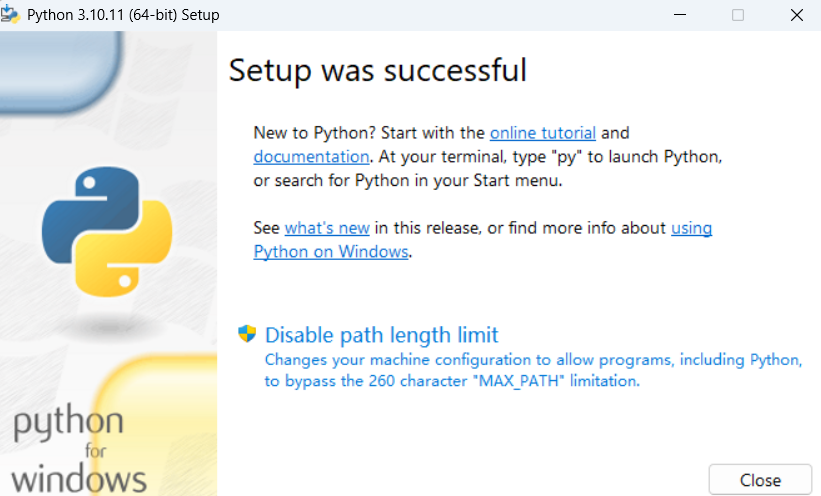
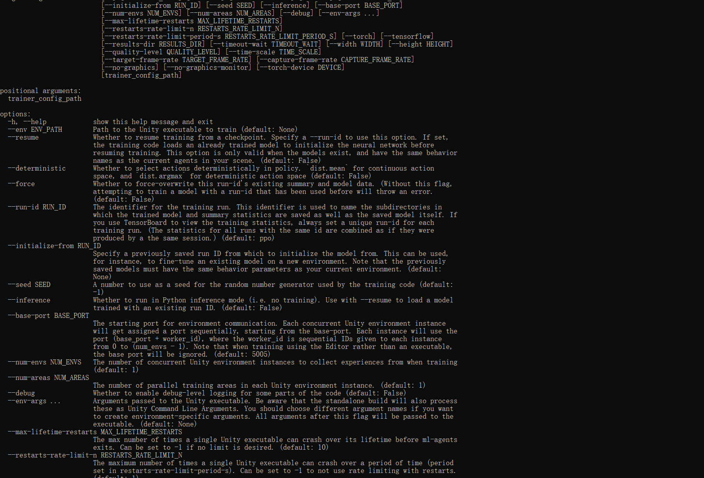
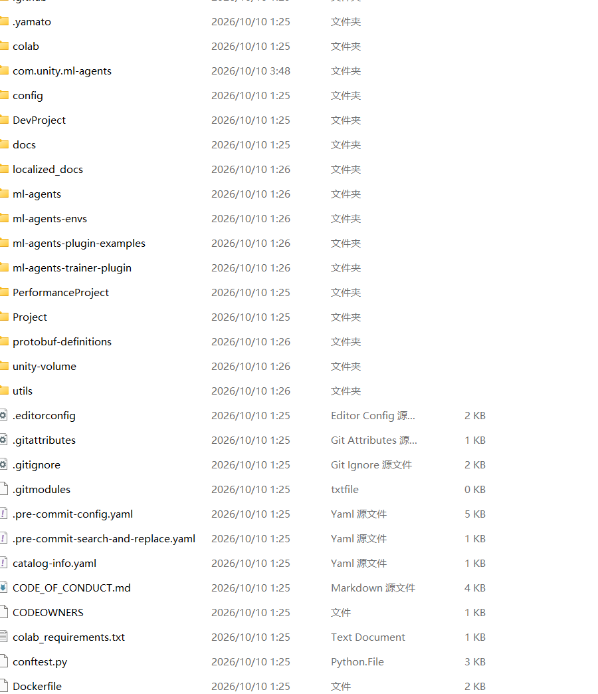
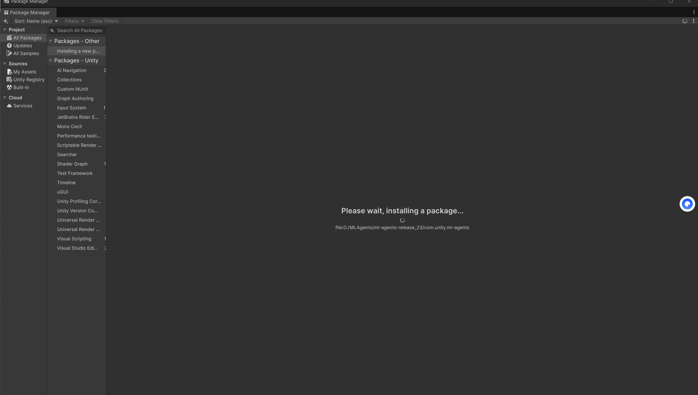
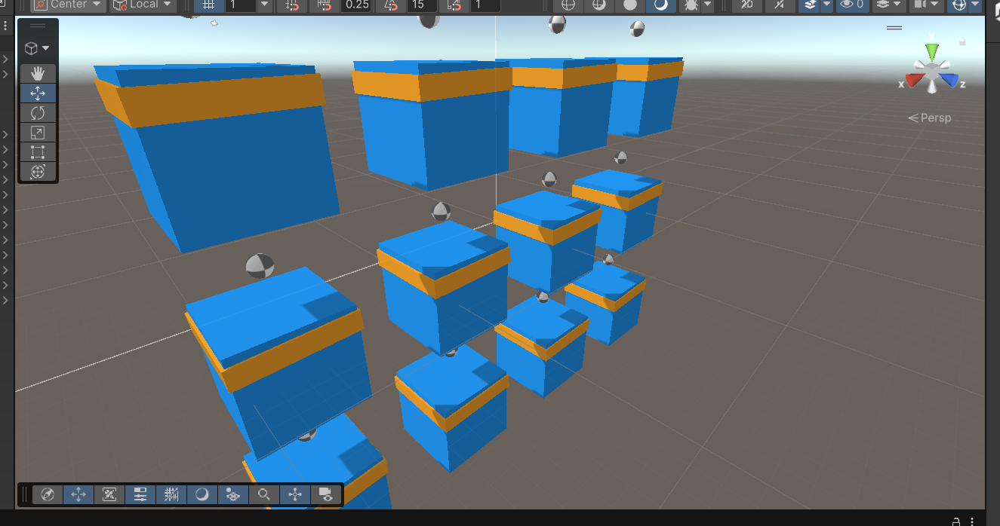
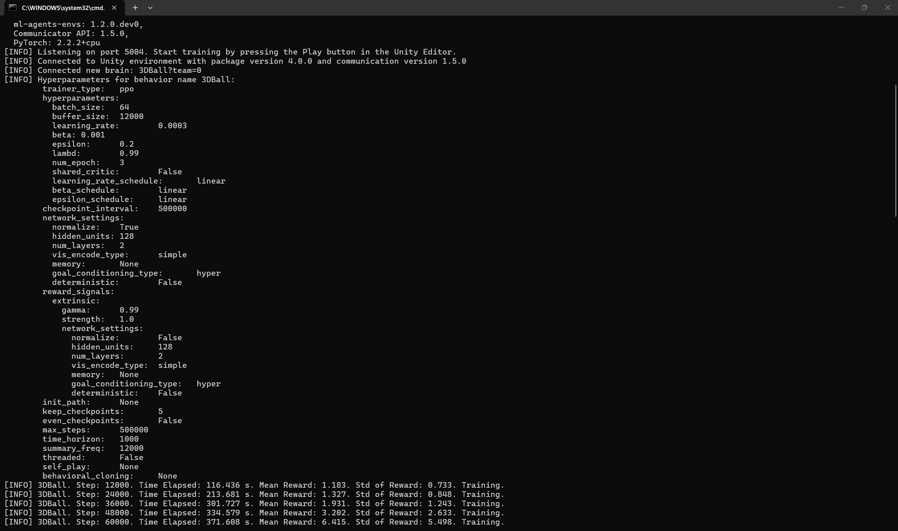
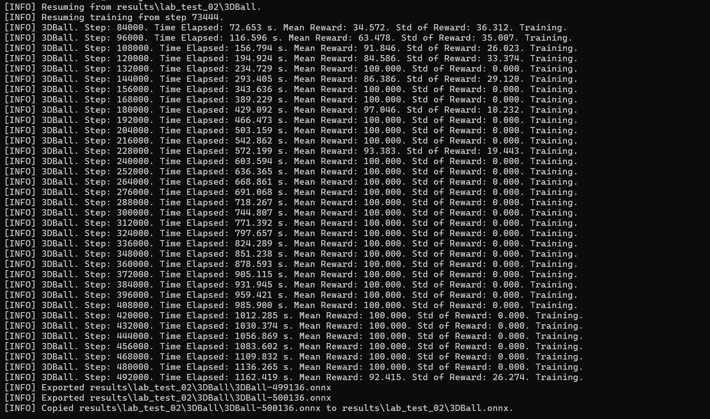
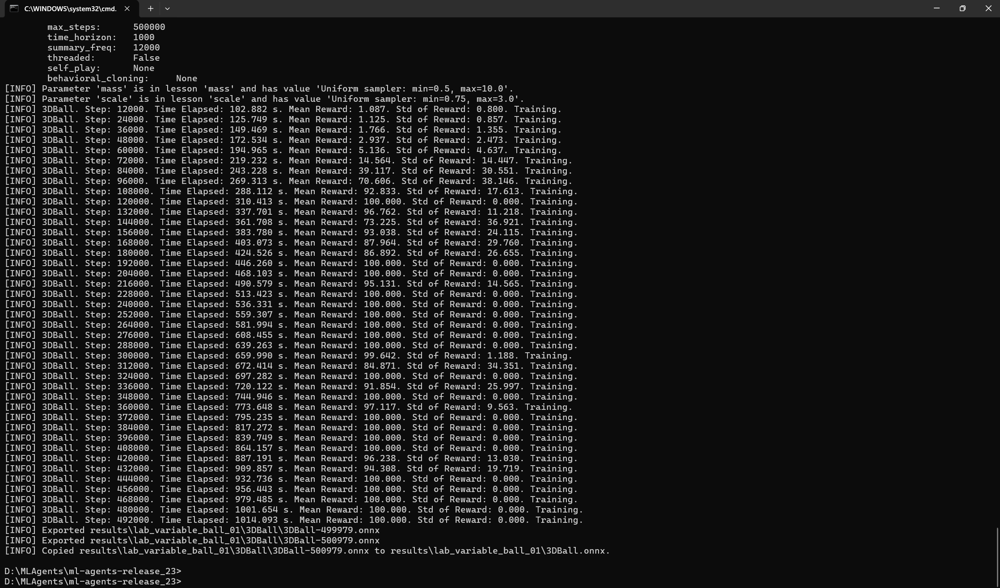
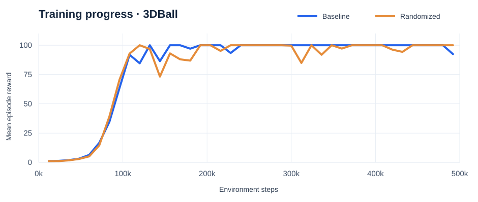

## Goal

This lab was about getting **Unity ML-Agents** working end to end: setting up Python and Unity, running an official reinforcement-learning example, and extending it to a new situation. I chose **3DBall**, where an agent tilts a platform to keep a ball from falling.

After verifying the standard example, I made a second training run with randomly changing ball **mass** and **size**. I wanted to see whether the policy could learn in a less predictable physical environment. Both trained models were then tested in Unity using ONNX inference.

## Environment and setup

I used **Unity 6000.6.5f1**, **Python 3.10.11**, the local **ML-Agents Release 23** source, and **PyTorch 2.2.2 (CPU)**. My Python installations reported matching editable-source versions of **mlagents 1.2.0.dev0** and **mlagents-envs 1.2.0.dev0**. The Unity package in Release 23 identifies itself as version **4.0.0**.

### Python and trainer

I started by installing Python 3.10.11 and checking that the training command could start. Running the ML-Agents help command was a useful first check, but it did not yet prove that Python and Unity could communicate.

### Files and Unity package

I kept the ML-Agents source and project on the D drive. The source release contains both the Python trainer and the Unity package.

I then added the local Unity package through Package Manager. This screenshot shows the installation process; successful integration was confirmed later by actually running 3DBall training.

### Compatibility problems and fixes

The first Unity 6000.6 launch entered Safe Mode because older ML-Agents code and some of its dependencies did not pass the newer editor's compilation and serialization checks. The errors included obsolete instance-ID APIs and serialization-analyzer diagnostics in runtime, third-party and example code.

I worked through the errors in stages, backing up source files before making local compatibility changes. Using an older Unity 6000.0 editor on a copy introduced additional package-dependency problems, so I returned to **6000.6.5f1**. After fixing the remaining example-script errors, the project compiled and I could run the scene.

This was an important lesson: a working Python command is only one part of the setup. The Unity project must compile, the correct package must load, and the training connection must work too.

## Standard 3DBall training

The 3DBall scene contains multiple copies of the agent. Each agent observes the platform orientation, the ball's relative position and its velocity, then predicts how to tilt the platform. The aim is to keep the ball balanced as long as possible.

I trained the standard task with **PPO**, using the supplied 3DBall configuration. The original ball uses the default mass and scale values of **1.0**. The Python terminal connected successfully to the Unity environment and began reporting training steps and mean rewards.

One early session timed out after roughly 73,000 steps when Unity stopped responding to the Python trainer. Instead of treating this as an installation failure, I resumed training and preserved the existing progress. The completed run reached **500,136 steps** and produced an ONNX model.

## Extension — balancing balls with variable physics

For the extension, I kept the same basic 3DBall task but randomized the physical characteristics of the ball between episodes. The aim was to train a policy that encounters different ball behavior rather than always seeing identical conditions.

The actual saved training configuration used these ranges:

| Environment parameter | Standard task | Randomized extension |
| --- | --- | --- |
| Ball mass | 1.0 | Uniformly sampled from 0.5 to 10.0 |
| Ball scale | 1.0 | Uniformly sampled from 0.75 to 3.0 |
| Training algorithm | PPO | PPO |
| Training target | 500,000 steps | 500,000 steps |

These are the values found in the saved training configurations, not estimates from the screenshots. The model was retrained in a separate run named **lab_variable_ball_01**, so the original result was kept for comparison.

## Results and comparison

The figures below come from the uploaded **TensorBoard event files** and final checkpoint status files. Mean reward is the average cumulative episode reward recorded during training, not a direct percentage of success.

| Measure | Standard 3DBall | Variable-physics 3DBall |
| --- | ---: | ---: |
| Final saved checkpoint | 500,136 steps | 500,979 steps |
| Mean reward at 72,000 steps | 16.73 | 14.56 |
| Mean reward at 120,000 steps | 84.59 | 100.00 |
| Last logged mean reward at 492,000 steps | 92.42 | 100.00 |
| Final checkpoint reward | ≈100 | ≈100 |
| Exported model | 3DBall.onnx | 3DBall.onnx |

Both runs learned to balance the ball and reached high rewards. The curves were not perfectly smooth: the baseline fell below 100 in its final sampled interval, and the randomized version had temporary dips along the way.

**Interpretation:** the variable-physics agent successfully trained under its randomized settings. However, these are two training runs under different conditions, not a controlled evaluation of both models on the exact same set of test episodes. They do **not** prove that the randomized policy is universally better.

The chart contains the 41 common logging points, sampled every 12,000 steps. [Download the processed reward data](training-rewards.csv).

## Running the trained policies in Unity

After training, I imported the exported ONNX models into Unity and set the agents' **Behavior Parameters** to **Inference Only**. This allows the policies to control the balancing platforms without launching the Python trainer.

### Standard 3DBall — inference recording



### Randomized-physics 3DBall — inference recording



Both recordings show the models running in the Unity scene. These are short demonstrations, not timed measurements of how long the ball stays balanced under comparable test conditions.

## Experiment files

The source training records are preserved in Google Drive:

| Artifact | Standard 3DBall | Variable-physics extension |
| --- | --- | --- |
| Final ONNX model | [Baseline model](https://drive.google.com/file/d/1mphO8hsAzUR4MO-6kLkRDvGE7hcSIzAS/view) | [Variable-physics model](https://drive.google.com/file/d/1XvVMGJUsCJIH4wxQkVw-B4nBCZpd3em_/view) |
| Saved configuration | [Baseline YAML](https://drive.google.com/file/d/1pwP8ju2IC-NhmJ8wF2OHC3OmcqTU3Vl3/view) | [Randomized YAML](https://drive.google.com/file/d/14ngRVZUFQP5DV9fFXQZCyyTJ1SFSfYxG/view) |
| Training status | [Baseline status](https://drive.google.com/file/d/1ygkHi6fNIYs0rw0PNLVeTOoAyTslHuZy/view) | [Randomized status](https://drive.google.com/file/d/1PQe3lL71HO5B4E_yR6es9yWkWVq5PHPO/view) |
| Raw training logs | [Baseline run folder](https://drive.google.com/drive/folders/1mJ4uIZsqQp3XRpM6P3ppVas_W-CHHZ3b) | [Randomized run folder](https://drive.google.com/drive/folders/12hQNPfk7oazKGwBHJxw0Sk4IyKJYJCne) |

## Reflection

The biggest challenge was getting the **Unity editor, ML-Agents package, Python trainer, and example project** working together. Resolving Safe Mode compilation issues taught me to separate installation problems from source compatibility problems, keep backups, and verify the entire pipeline by running real training rather than checking commands alone.

The extension also showed that a small change to an environment's parameters can create a meaningful new training task without redesigning the whole scene. Both runs eventually achieved high rewards, and I successfully used the exported policies for inference.

For a stronger follow-up study, I would test **both models** across the **same predefined set of ball masses and sizes**, repeat each test several times, and record average balance duration and failure rates. That would provide evidence about generalization rather than relying only on training curves and short videos.
